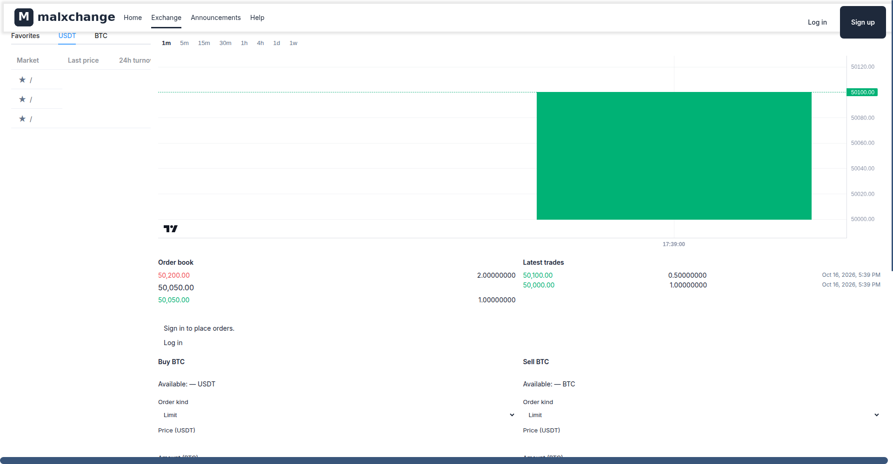
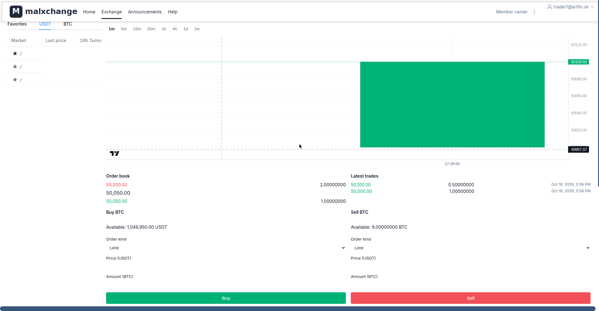

# malxchange

An open-source crypto exchange platform designed for **low-resource environments**. Run a full-featured spot exchange — matching engine, wallets, admin panel — on a single **4GB VPS** for ~€4/month.


---

## Features

### Trading

- **Real matching engine** — price-time priority, partial fills, market & limit orders
- **Live charts** — TradingView-powered candlestick charts with real-time updates
- **Order book** — live bid/ask depth
- **WebSocket feeds** — tickers, trades, order updates in real time

### Member Center

- **Assets** — portfolio overview with live balances
- **Deposit** — on-chain deposits with address generation (BTC, LTC)
- **Withdraw** — withdrawals with address book management
- **Order history** — current and historical orders with fill details

### Admin Panel
*Admin panel screenshots coming soon*
- **Dashboard** — platform overview, key metrics
- **Member management** — search, freeze, review members
- **Order oversight** — monitor all orders and trades
- **Reconciliation** — ledger vs journal integrity checks
- **Announcements** — publish platform notices
- **TOTP 2FA** — hardware-grade admin security (see setup below)

### Security
- Email verification for registration
- TOTP two-factor auth for admins
- Per-service Postgres roles (no cross-service DB access)
- Ledger/journal double-entry accounting with reconciliation

---

## Architecture

```
┌─────────────────────────────────────────┐
│              Single VPS                 │
│                                         │
│  ┌──────────┐  ┌──────────────────────┐ │
│  │  Caddy   │  │   5 Go microservices │ │
│  │ (TLS)    │  │   api, exchange,     │ │
│  └──────────┘  │   market, wallet,    │ │
│                │   admin-api          │ │
│                └──────────────────────┘ │
│  ┌──────────┐  ┌──────────┐ ┌────────┐  │
│  │ Postgres │  │ Redpanda │ │ Nuxt   │  │
│  │   17     │  │ (Kafka)  │ │ web +  │  │
│  └──────────┘  └──────────┘ │ admin  │  │
│                             └────────┘  │
└─────────────────────────────────────────┘
```

| Service | Description | RAM |
|---------|-------------|-----|
| `api` | Member REST API (auth, orders, wallets) | ~20 MB |
| `exchange` | Matching engine (order books, fills) | ~20 MB |
| `market` | Tickers, candles, market data | ~10 MB |
| `wallet` | Deposits, withdrawals, ledger | ~20 MB |
| `admin-api` | Admin REST API | ~10 MB |
| `web` | Member frontend (Nuxt 3) | ~75 MB |
| `admin` | Admin frontend (Nuxt SSR) | ~70 MB |
| `postgres` | PostgreSQL 17 (5 schemas) | ~250 MB |
| `redpanda` | Kafka-compatible event bus | ~400 MB |

**Total: ~1.1 GB** — fits comfortably on a 4GB VPS.

See [DEPLOYMENT_OPTIONS.md](DEPLOYMENT_OPTIONS.md) for split-service deployments (Vercel + managed DB/Kafka).

---

## Quick Start

### Prerequisites
- Docker + Docker Compose
- A VPS with 4GB+ RAM (or local machine for dev)
- A domain name (for production)

### 1. Clone
```bash
git clone https://github.com/syaikhipin/malxchange.git
cd malxchange
```

### 2. Configure
```bash
cp deploy/.env.example deploy/.env
# Edit deploy/.env — set passwords and domains
```

Required variables:
```bash
MAL_PG_SUPERUSER_PASSWORD=<strong-password>
MAL_PG_PASSWORD_API=<strong-password>
MAL_PG_PASSWORD_EXCHANGE=<strong-password>
MAL_PG_PASSWORD_MARKET=<strong-password>
MAL_PG_PASSWORD_WALLET=<strong-password>
MAL_PG_PASSWORD_ADMIN=<strong-password>
MAL_ADMIN_BOOTSTRAP_EMAIL=admin@yourdomain.com
```

### 3. Launch
```bash
cd deploy
docker compose -f docker-compose.yaml -f compose.demo-ltcd.yaml --profile chains up -d
```

This starts everything: Postgres, Redpanda, 5 Go services, both frontends, Caddy, and simnet chain nodes (ltcd/btcd for testing deposits).

### 4. Access
- **Member**: https://yourdomain.com
- **Admin**: https://admin.yourdomain.com

---

## Admin TOTP Setup

Admin accounts require TOTP two-factor authentication. Here's how to set it up:

### Step 1: Create the admin account
```bash
# The bootstrap admin is created on first run using:
# MAL_ADMIN_BOOTSTRAP_EMAIL from your .env
# Check logs for the temporary password:
docker logs malxchange-admin-api-1 2>&1 | grep -i "bootstrap\|password"
```

### Step 2: Log in (first time)
1. Go to `https://admin.yourdomain.com/login`
2. Enter the admin email and temporary password
3. You'll be prompted to set up TOTP

### Step 3: Scan the QR code
1. The admin panel will display a **QR code**
2. Open your authenticator app (Google Authenticator, Authy, 1Password, etc.)
3. Tap **+** → **Scan QR code**
4. Point your camera at the QR code

### Step 4: Verify
1. Enter the 6-digit code from your authenticator app
2. Click **Verify** — TOTP is now bound to your account
3. **Save your backup codes** in a safe place

### Step 5: Change your password
After first login, go to **Profile → Change Password** and set a strong password.

### Resetting TOTP (if you lose your device)
```bash
# On the VPS, clear the TOTP binding (requires DB access):
docker exec malxchange-postgres-1 psql -U malxchange -d malxchange \
  -c "UPDATE admin.employees SET totp_secret=NULL, totp_bound_at=NULL WHERE email='admin@yourdomain.com';"
# Then log in again — you'll be prompted to set up TOTP fresh
```

---

## Seeding Sample Data

Populate the exchange with demo users, balances, and trading activity:

```bash
# On the VPS
cd /root/malxchange
./scripts/seed-demo.sh
```

This creates:
- **5 demo traders** (`trader1@example.com` … `trader5@example.com`, password `Trader1123!` etc.)
- Each funded with **10 BTC + 1,000,000 USDT**
- Sample **deposit records**, **withdraw addresses**, and **favorites**
- Places **matching orders** to generate trade history and chart data

### Manual seeding (step by step)

If you prefer to seed manually:

```bash
# 1. Create traders via the API
for i in 1 2 3 4 5; do
  curl -X POST https://yourdomain.com/api/uc/register/code \
    -H "Content-Type: application/json" \
    -d "{\"email\": \"trader$i@example.com\"}"
  # ... enter code, set password
done

# 2. Fund via SQL (demo only — never in production!)
docker exec malxchange-postgres-1 psql -U malxchange -d malxchange \
  -c "INSERT INTO wallet.ledger_accounts (member_id, coin, available)
      SELECT id, 'BTC', 10 FROM api.members WHERE email LIKE 'trader%@example.com'
      ON CONFLICT DO NOTHING;"

# 3. Place orders via the API to generate trades
# (see scripts/seed-demo.sh for the full flow)
```

---

## API Reference

### Public endpoints
```
GET  /api/market/tickers          # All market tickers
GET  /api/market/depth/{pair}     # Order book depth
GET  /api/market/trades/{pair}    # Recent trades
GET  /api/market/candles/{pair}   # OHLC candles
```

### Authenticated endpoints
```
POST /api/uc/register/code        # Request email verification code
POST /api/uc/register             # Register with code
POST /api/uc/login                # Login (returns token)
GET  /api/uc/wallet/accounts      # Balances
POST /api/uc/orders               # Place order
GET  /api/uc/orders/current       # Open orders
GET  /api/uc/orders/history       # Order history
```

### WebSocket
```
wss://yourdomain.com/ws           # Live tickers, trades, order book
```

---

## Development

```bash
# Run Go tests
go test ./...

# Run frontend dev server
cd apps/web && npm run dev

# Run admin dev server
cd apps/admin && npm run dev
```

---

## Deployment Options

See [DEPLOYMENT_OPTIONS.md](DEPLOYMENT_OPTIONS.md) for:
- **Option A**: All-in-one VPS (~€4/month)
- **Option B**: Split — Vercel frontends + managed Postgres/Kafka (~€11/month)

---

## License

MIT — see [LICENSE](LICENSE) for details.

---

## Contributing

Pull requests welcome! Please:
1. Fork the repo
2. Create a feature branch
3. Add tests for new functionality
4. Submit a PR with a clear description
